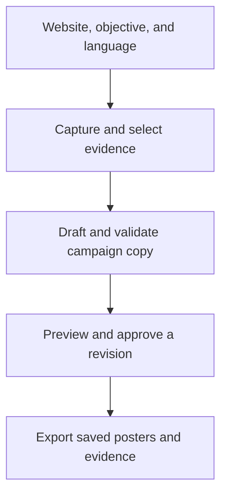

# ADZY

**An AI campaign workflow that links claims to publisher evidence and exports the exact revision a reviewer approved.**

Start with a brand website, a campaign objective, and a language. ADZY gathers evidence, drafts a campaign brief, and lets a reviewer edit the copy, preview both poster sizes, approve a revision, and download the campaign.

[See the campaign](#buffalo-burger-showcase) · [Inspect the engineering evidence](#engineering-evidence) · [Run the demo](#replay-from-a-clean-checkout)

## Buffalo Burger showcase


The campaign compares Old School and Rastafari and directs readers to the official menu. This independent portfolio study uses editor-reviewed copy and an AI-generated illustrative scene. Gemini on Vertex AI generated the scene during campaign production. The demo uses the stored scene and captured publisher evidence.

[Full-size portrait](docs/campaigns/buffalo/portfolio/poster-portrait.png) · [Square poster](docs/campaigns/buffalo/portfolio/poster-square.png) · [Campaign ZIP](docs/campaigns/buffalo/portfolio/campaign.zip) · [Design iterations and provenance](docs/campaigns/buffalo/portfolio/REVIEW.md)

## Engineering evidence

| Scenario | Verified behavior | Evidence |
| --- | --- | --- |
| An edit assigns jalapeño to Old School | ADZY returns HTTP `409` and identifies the headline as requiring evidence review. | [Rejected edit](https://github.com/asmaasamyhagag22-design/adzy/blob/main/docs/campaigns/buffalo/portfolio/rejected.json) |
| A reviewer switches campaign direction after approval | The export for the stale revision returns HTTP `409`. | [Browser test result](docs/campaigns/buffalo/portfolio/browser-result.json) |
| The app restarts after export | The approved ZIP is recovered byte for byte within the same run. The clean checkout replay also reproduces both poster images in the tested environment. | [Live browser test](docs/campaigns/buffalo/portfolio/browser-result.json) · [Clean checkout replay](https://github.com/asmaasamyhagag22-design/adzy/blob/main/docs/campaigns/buffalo/portfolio/replay-result.json) |
| Five Guys has two similarly named burgers | On the same saved source snapshot, the original planner selected Little Bacon Burger for a Bacon Burger brief. The corrected planner selected Bacon Burger. | [Before and after](https://github.com/asmaasamyhagag22-design/adzy/blob/main/docs/campaigns/buffalo/review/README.md) |

The campaign release workflow evaluates copy policies on frozen source snapshots. The local release exercise deliberately reintroduced a wrong-product selection and an unsupported claim. The check reported `KEEP_STABLE` and exited with status `1`. The release also published successful hosted workflow runs for Campaign Replay and Poster V1. [Release exercise and rollback](https://github.com/asmaasamyhagag22-design/adzy/blob/main/docs/campaigns/lifecycle/README.md) · [Campaign Replay](https://github.com/asmaasamyhagag22-design/adzy/actions/runs/43523158284) · [Poster V1](https://github.com/asmaasamyhagag22-design/adzy/actions/runs/43523157672)

## How it works



The planner records publisher quotes and source context. PostgreSQL stores campaign revisions and their approvals. The renderer composes the reviewed scene and copy with Chromium. The export path checks the current revision and approval before and after rendering, then packages the saved images with their evidence and export receipt. [Code walkthrough](docs/campaigns/INTERVIEW.md) · [Example export receipt](docs/campaigns/buffalo/portfolio/campaign.json)

## Replay from a clean checkout

Use Linux, Python 3.12, Docker, and Playwright Chromium. Run these commands from the repository root. The snapshot demo starts a disposable PostgreSQL instance on loopback, uses stored scenes and captured publisher evidence, and makes zero paid model calls.

```bash
python3.12 -m venv .venv
source .venv/bin/activate
python -m pip install -r requirements-app.txt
python -m playwright install chromium
docker pull postgres:16-alpine

demo_dir=$(mktemp -d)/demo
python -m workflows.public_campaign_demo init --directory "$demo_dir"
ADZY_CAMPAIGN_EDITIONS_FILE="$PWD/docs/campaigns/buffalo/portfolio/edition.json" \
  python -m workflows.public_campaign_demo serve --directory "$demo_dir" \
  --snapshot docs/demo/campaign-snapshots/buffalo --port 8020
```

1. Open [the local app](http://127.0.0.1:8020/app) and sign in with the credentials printed by `init`.
2. Open **Campaign**. Enter `https://buffaloburger.com`, set the objective to `تشجيع المستخدم على تصفّح المنيو واختيار برجر يناسبه`, and select Arabic.
3. Review the publisher quotes and campaign directions. In **تعديل نص الاتجاه**, try the reviewed message `الاتنين فيهم صوص بافالو.`. Save the brief, preview both sizes, approve the current revision, and download the ZIP.
4. Stop the server and run the same `serve` command with the same directory to check recovery. After stopping the demo, run `python -m workflows.public_campaign_demo cleanup --directory "$demo_dir"`.

If Chromium needs system libraries, run `python -m playwright install-deps chromium`.

## Verify the release

```bash
check_dir=$(mktemp -d)
ADZY_CAMPAIGN_EDITIONS_FILE="$PWD/docs/campaigns/buffalo/portfolio/edition.json" \
  python tools/verify_public_campaign_browser.py --directory "$check_dir/demo" \
  --evidence-dir "$check_dir/browser" \
  --snapshot docs/demo/campaign-snapshots/buffalo \
  --planner-cases docs/campaigns/buffalo/portfolio/case.json

python -m workflows.campaign_eval --output "$check_dir/replay.json"
```

Omit `--snapshot` to test current source retrieval. Add `--check-destination` to open the live menu in Chromium. A fresh run creates its own review identifiers. The restart check compares the recovered ZIP with the export from that run.

## Scope

The Buffalo showcase uses a curated campaign edition and stored artwork. The published visual review records the separate Gemini generation and critique steps. The browser tests use demo approvals, and the campaign's effect on audience behavior remains unmeasured. [Visual review and model usage](docs/campaigns/buffalo/portfolio/REVIEW.md) · [Asset notes](THIRD_PARTY_ASSETS.md)
