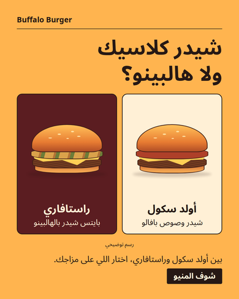

# ADZY



[Portrait PNG, 1080 × 1350](docs/campaigns/buffalo/menu/poster-portrait.png) · [Square PNG, 1080 × 1080](docs/campaigns/buffalo/menu/poster-square.png) · [Review ZIP](docs/campaigns/buffalo/menu/campaign.zip) · [Before, alternate, and selected at mobile scale](docs/campaigns/buffalo/review/comparison.png)

ADZY turns a **publisher URL, campaign objective, and language** into an evidence-linked brief, directions for human review, and two locally rendered poster sizes. The review ZIP includes both PNGs and a JSON receipt with the source quotes, field bindings, selected direction, run, approval, and PNG checksums. The PNG contains a CTA label. The app and JSON carry its destination. [Buffalo export receipt](docs/campaigns/buffalo/menu/campaign.json)

| Run | What goes in | What the app does |
|---|---|---|
| **Buffalo editorial showcase** | The same three inputs plus a local file of editor-written directions, copy, illustration choices, field-to-source mappings, and expected publisher text. | Matches the edition to the request, reads and checks the specified fields and item titles, stores a reviewable brief, checks edits and approval, and renders the selected design. [Edition data](docs/campaigns/buffalo/editions.json) · [Matching and field capture](strategy/campaign_editions.py) |
| **General planner** | URL, objective, and language. | Reads bounded same-origin HTML, selects a passage for the objective, proposes directions, and produces the same review and export format when the evidence suffices. Its default writing is conservative and can use the publisher's section title in the poster. [Planner](strategy/campaign_planner.py) · [Nando’s export](docs/campaigns/buffalo/review/nandos/campaign.json) |

For the Five Guys goal naming **Bacon Burger**, the previous planner selected **Little Bacon Burger**. With the same captured HTML, the revised planner prioritizes the publisher section explicitly named in the goal and produces a poster for **Bacon Burger**. The HTTP regression also removes the requested item's evidence and tries a passage explicitly about the smaller variant. Both cases withhold the package. [Before export](docs/campaigns/buffalo/review/five-guys-before/campaign.json) · [After export](docs/campaigns/buffalo/review/five-guys-after/campaign.json) · [Regression test](tests/test_campaign_planner.py)

## Replay Buffalo from a clean checkout

Use Linux, Python 3.12, Docker, and Playwright Chromium. The local demo uses a disposable PostgreSQL container and project fonts. The app binds to loopback and the demo disables paid providers and telemetry.

```bash
python3.12 -m venv .venv-review
source .venv-review/bin/activate
python -m pip install -r requirements-app.txt
python -m pip check
python -m playwright install chromium
docker pull postgres:16-alpine

demo_dir=$(mktemp -d)/demo
python -m workflows.public_campaign_demo init --directory "$demo_dir"
ADZY_CAMPAIGN_EDITIONS_FILE="$PWD/docs/campaigns/buffalo/editions.json" \
  python -m workflows.public_campaign_demo serve --directory "$demo_dir" \
  --snapshot docs/demo/campaign-snapshots/buffalo --port 8020
```

On a Linux host that still needs Chromium's system libraries, install them with `python -m playwright install-deps chromium` using an account with system package access.

1. Open [the local app](http://127.0.0.1:8020/app). Sign in with the demo credentials printed by `init`.
2. Select **Campaign**. Enter `https://buffaloburger.com`, the goal `تشجيع المستخدم على تصفّح المنيو واختيار برجر يناسبه`, and Arabic. Submit and inspect the source quote for each field.
3. Open **تعديل نص الاتجاه**, put `كل برجر في المنيو فيه هالبينو` in the headline, and save. The app marks the headline and preserves the attempted edit. Restore the headline and click the reviewed message **الاتنين فيهم صوص بافالو.** Save the brief.
4. Preview both sizes, approve the current version, and download the ZIP. Choose the Rastafari direction and see that the new version requires review. To reopen the last saved version, stop the server and repeat the same `serve` command with the same directory.

After stopping the server, run `python -m workflows.public_campaign_demo cleanup --directory "$demo_dir"` to remove its container. Keep the same demo directory and container for the restart check.

The source fixtures contain dated, trimmed publisher HTML and capture checksums. The demo uses a frozen clock and refuses URLs outside the snapshot. [Snapshot contents and dates](docs/demo/campaign-snapshots/README.md) · [Asset provenance](THIRD_PARTY_ASSETS.md)

## Verify the browser journey and live sources

```bash
check_dir=$(mktemp -d)
ADZY_CAMPAIGN_EDITIONS_FILE="$PWD/docs/campaigns/buffalo/editions.json" \
  python tools/verify_public_campaign_browser.py --directory "$check_dir/buffalo" \
  --evidence-dir "$check_dir/buffalo-results" \
  --snapshot docs/demo/campaign-snapshots/buffalo \
  --planner-cases docs/campaigns/buffalo/cases.json --case-name menu

env -u ADZY_CAMPAIGN_EDITIONS_FILE python tools/verify_public_campaign_browser.py \
  --directory "$check_dir/general" --evidence-dir "$check_dir/general-results" \
  --snapshot docs/demo/campaign-snapshots/nandos \
  --planner-cases docs/demo/campaign-snapshots/nandos-case.json

python -m workflows.verify -q tests/test_campaign_editions.py tests/test_campaign_planner.py \
  tests/test_public_campaign_package.py tests/test_adzy_v2_campaign.py tests/test_adzy_v2_research.py \
  tests/test_ssrf_coverage.py tests/test_route_persistence_classification_2gb.py tests/test_security_headers.py
```

Use a fresh directory and omit `--snapshot` for a live-source run. For example, pass `docs/demo/campaign-snapshots/five-guys-case.json` to the general-planner browser command. The verifier records both export and evidence-gap outcomes in `result.json`. For a separate live check of the menu link from the Buffalo review card, add `--check-destination` to the Buffalo snapshot command. This opens the publisher's site in Chromium. [Live test results](docs/campaigns/buffalo/review/live/README.md)

## What the checks establish

The clean checkout passed **142 focused tests** and the Chromium journeys for Buffalo, Five Guys, and Nando’s. [Verification receipt](docs/campaigns/buffalo/review/clean-checkout.json)

- The Buffalo browser journey saved a reviewed alternative and refused the menu-wide jalapeño claim in the headline field. A different, reasonable paraphrase outside the edition’s reviewed wording also returned 409. [Browser receipt](docs/campaigns/buffalo/menu/browser-result.json) · [Rejected field](docs/campaigns/buffalo/menu/rejected.png)
- The browser verified both PNG hashes, refused export of a superseded run, and downloaded an identical ZIP after a server restart. HTTP tests change the run or approval during rendering and assert refusal. [Export boundary](api/routes/v2_campaigns.py) · [HTTP tests](tests/test_public_campaign_package.py) · [Run and approval storage](db/campaign_v2.py)
- The general planner matches explicit section phrases using bounded HTML. Named-section coverage depends on publisher markup and vocabulary, and the ranking does not prove semantic entailment. The Nando’s snapshot exported, while live acquisition stopped at the HTML size limit. Audience fit, copy beyond approved wording, and ad performance require independent review. [Execution notes and measured limits](docs/campaigns/buffalo/EXECUTION.md)

The repository also includes separate strategy and creative workflows. [Arabic engineering walkthrough](docs/campaigns/INTERVIEW.md) · [Application architecture](docs/architecture/app_review.md) · [Other demo modes](docs/demo/README.md)

## Campaign release lifecycle

The [replay protocol](docs/campaigns/lifecycle/PROTOCOL.md) freezes the case labels and release conditions. The same gate runs both review policies against hashed publisher snapshots, reports the decision as JSON, and exits with status 1 when the candidate is blocked. The default policy is `stable`. The deterministic Campaign path uses no model calls or model prompts.

With the dependencies, Chromium, and PostgreSQL image installed as above:

```bash
output=$(mktemp -d)
python -m workflows.campaign_eval --output "$output/replay.json"
python tools/demo_campaign_lifecycle.py --output-dir "$output/demo"
python -m workflows.campaign_monitor "$output/demo/server.log"
```

The demo checks the gate before starting the candidate, exercises the authenticated Campaign API and both PNG exports, triggers a simulated source incident, and restarts on the stable policy. It records the alert, the old approval and proposal identifiers, and the byte comparison in `result.json`. Its database is disposable.

For separate public-source diagnostics, run `python -m workflows.campaign_eval --live --output "$output/live.json"`. To reproduce the failed CI job and the rollback, follow the [lifecycle walkthrough](docs/campaigns/lifecycle/README.md). The [interview guide](docs/campaigns/INTERVIEW.md#دورة-إصدار-campaign) traces the decisions to functions and tests.
